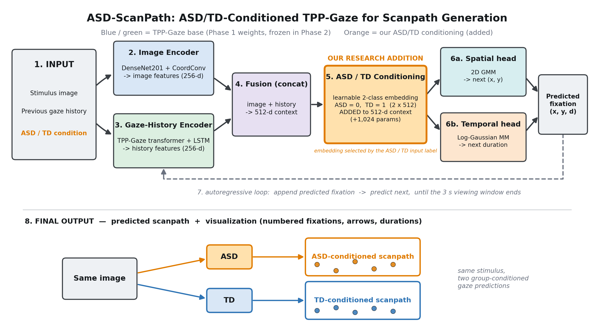

# ASD-ScanPath: ASD/TD-Conditioned TPP-Gaze

ASD-ScanPath tests what changes when a scanpath model is told whether a viewer is an autistic (ASD) or a typically developing (TD) child.
- **Starting point:** [TPP-Gaze](https://github.com/phuselab/tppgaze) (D'Amelio et al., WACV 2025), a neural temporal point process that predicts where the next fixation lands and how long it lasts.
- **What we did:**
  1. fine-tuned TPP-Gaze on child gaze data;
  2. added a minimal 1,024-parameter ASD/TD group embedding;
  3. evaluated the result on held-out images, on an external dataset, and through the scanpaths it generates.

> **Research use only.** These are group-level computational results. This is **not** a diagnostic or screening tool, and no clinical validity is established. Generated scanpaths are samples from a group-level model and do not represent any individual child.

> **Data are not included.** No dataset, participant record, stimulus photograph or model checkpoint is distributed in this repository. See [Datasets](#6-datasets) and [`docs/dataset_documentation.md`](docs/dataset_documentation.md).

**Main finding.** The negative result is the main finding:
- **Fine-tuning helped:** Phase 1 improves the held-out likelihood clearly.
- **Likelihood:** the ASD/TD embedding gives only a small, statistically inconclusive in-domain gain, and it makes the external fit **worse**.
- **Generated scanpaths:** the embedding does change them. Some spatial ASD−TD differences appear in the real direction at reduced size; several other differences have the wrong direction; and neither group becomes more realistic.

See [Main results](#13-main-verified-results).

---

## Contents

1. [Research objective](#1-research-objective)
2. [What we implemented](#2-what-we-implemented)
3. [Architecture](#3-architecture)
4. [Phase 1 and Phase 2](#4-phase-1-and-phase-2)
5. [Repository structure](#5-repository-structure)
6. [Datasets](#6-datasets)
7. [Installation](#7-installation)
8. [Dataset setup](#8-dataset-setup)
9. [Preprocessing](#9-preprocessing)
10. [Training](#10-training)
11. [Evaluation](#11-evaluation)
12. [Inference and demo](#12-inference-and-demo)
13. [Main verified results](#13-main-verified-results)
14. [Limitations](#14-limitations)
15. [Reproducibility](#15-reproducibility)
16. [References and citation](#16-references-and-citation)

---

## 1. Research objective

**Research question.** If one shared TPP-Gaze model receives only a small ASD/TD label, what changes?

| | Question | Evaluated by |
|---|---|---|
| Q1 | Does the label improve the fit to held-out Saliency4ASD scanpaths? | Likelihood, in-domain |
| Q2 | Does any improvement transfer to Gaze4ASD, a dataset never used for training? | Likelihood, external |
| Q3 | Do generated ASD and TD scanpaths differ the way real ASD and TD children do, and does either group become more realistic? | Generated behaviour |

**Why a minimal label.** Separate ASD and TD models would differ in every weight, so a difference between them could come from the group or from training noise. A shared model with a zero-initialised embedding isolates the effect of the label. A detailed motivation is in [`docs/research_overview.md`](docs/research_overview.md).

## 2. What we implemented

**Original TPP-Gaze, unchanged** (in [`tppgaze/`](tppgaze/UPSTREAM.md); all source code byte-identical to upstream commit `59cf572`, MIT licence; the upstream sample photo `data/1009.jpg` is not distributed):
- the released code and pretrained transformer weights;
- the DenseNet201 + CoordConv image encoder;
- the transformer + LSTM history encoder;
- the 16-component spatial and 4-component duration mixture heads;
- the joint NLL objective and the sampler.

**Our work:**

| Component | Files |
|---|---|
| Saliency4ASD and Gaze4ASD preprocessing, including a corrected Gaze4ASD coordinate mapping | [`preprocessing/`](preprocessing/README.md) |
| Phase 1 fine-tuning and Phase 2 embedding-only training | [`training/train_tpp.py`](training/train_tpp.py), [`training/train_tpp_cond.py`](training/train_tpp_cond.py) |
| The ASD/TD conditioning wrapper and conditioned sampler; the base package is not modified | [`training/conditioned.py`](training/conditioned.py), [`training/generate_cond.py`](training/generate_cond.py) |
| Likelihood evaluation (in-domain and external), behavioural metrics, MultiMatch, statistics | [`training/`](training/README.md), [`scripts/research_completion/`](scripts/README.md) |
| Inference and scanpath visualization | [`inference/`](inference/README.md) |

Our settings that differ from the released configuration:
- sampling temperature τ = 1 (the released config uses 2);
- log-duration normalisation computed on our training split;
- at least 3 fixations per scanpath (the TPP-Gaze paper used 4).

Where each component comes from is documented in [`docs/architecture.md`](docs/architecture.md).

## 3. Architecture



*Blue and green: unchanged TPP-Gaze. Orange: our ASD/TD embedding ([SVG version](docs/figures/architecture_diagram.svg)).*

**Encoding.**
- The image is encoded by a frozen DenseNet201 with CoordConv into a 256-d vector *z*.
- The gaze history (previous locations and log-durations) is encoded by the transformer and LSTM into a 256-d state *h*.
- Together they form the context *c* = [*h* ‖ *z*] ∈ ℝ⁵¹².

**Prediction heads.** From the context:
- a 16-component diagonal Gaussian mixture predicts the next location;
- a 4-component log-normal mixture predicts the next duration.

**Our conditioning.** The ASD/TD label selects one row *e*ℓ of a zero-initialised `nn.Embedding(2, 512)`, which is **added** to the context before both heads: *c̃* = *c* + *e*ℓ.
- It is added at every step, identically in training, likelihood scoring and sampling.
- Adding (rather than concatenating) keeps the heads' input size, so the pretrained heads load unchanged.

**Released-code quirk, kept on purpose.** The released transformer attends across the scanpaths in a batch rather than along each sequence (a `batch_first` layout issue). We kept it because the pretrained weights were learned with it.
- On Gaze4ASD likelihood it changes overall NLL by about 0.0001 or less.
- In generation, scanpaths sampled together can influence each other.

## 4. Phase 1 and Phase 2

| | Phase 1: fine-tune | Phase 2: label only |
|---|---|---|
| Purpose | Adapt TPP-Gaze to child gaze data | Isolate what the ASD/TD label adds |
| Starts from | Released TPP-Gaze weights | Best Phase 1 checkpoint |
| Trained parameters | 3,881,784 (DenseNet201 frozen and its features cached) | 1,024 (the 2 × 512 embedding); the whole base frozen and kept in evaluation mode |
| Optimiser | AdamW, lr 10⁻³, weight decay 0.1, batch 128, gradient clip 5 | Same, but lr 10⁻⁴ |
| Stopping | Early stopping, patience 20; best epoch 6 of 26 | Best epoch 8 of 28 |
| Best validation NLL | −0.5845 (−0.384 by epoch 26: early stopping mattered) | −0.5845 → −0.5964 |
| Config | [`configs/phase1_baseline.yaml`](configs/phase1_baseline.yaml) | [`configs/phase2_embedding_only.yaml`](configs/phase2_embedding_only.yaml) |

**Why the comparison is clean.** All 1,290 base weight tensors are identical in the two checkpoints, so Phase 1 is exactly Phase 2 with a zero embedding.

**Model selection used validation data only.** Validation images chose the checkpoints and the sampling temperature. Test images and Gaze4ASD were never used for training or selection.

## 5. Repository structure

```text
ASD-ScanPath/
├── README.md                  this file
├── requirements.txt           pip dependencies
├── environment.yml            conda environment
├── configs/                   Phase 1 and Phase 2 training configurations
├── tppgaze/                   original TPP-Gaze implementation (unmodified upstream code, MIT licence; sample photo omitted)
├── preprocessing/             Saliency4ASD and Gaze4ASD preprocessing, validation and sensitivity checks
├── training/                  Python package: conditioning wrapper, sampler, data loading, training,
│                              evaluation, statistics and result builders
├── inference/                 inference.py (scanpath generation and visualization) and the curated demo
├── scripts/                   research-completion experiments (E1–E3, A3–A6), result collection, figures
├── results/                   curated, group-level result summaries and figures (start with results/final/)
├── docs/                      research documentation, guides, audits and the repository audit
├── presentation/              supervisor presentation, speaking scripts and supporting material
├── tests/                     lightweight tests (no dataset needed)
└── archive/                   superseded code, configuration and results, kept for provenance
```

The role of every folder and file is described in its own `README.md`, and in [`docs/handover_guide.md`](docs/handover_guide.md). The following are **not** in the repository and are ignored by Git:
- the datasets (`TrainingData/`, `external_data/`) and processed data (`processed_data/`);
- the checkpoints and raw experiment outputs (`training/runs/`);
- the unpublished manuscript (`paper/`);
- local-only restricted material (`local_only/`, `**/local_only*/`).

## 6. Datasets

| | Saliency4ASD | Gaze4ASD |
|---|---|---|
| Role | Training, validation and held-out test | External evaluation only (frozen models) |
| Images | 300 natural images from MIT1003; split by image 210 / 45 / 45 (seed 0) | 30 stimuli, mostly faces, selected for ASD/TD differences |
| Data after preprocessing | 2,705 ASD and 3,324 TD scanpaths (train/val/test 4,229 / 897 / 903) | 771 ASD and 3,605 TD trials from 33 ASD and 133 TD children |
| Age | ASD 5–12 years (mean 8) | 3–7 years (group means 5.04 ASD, 4.54 TD) |
| Recording | Tobii T120, 1280 × 1024, 3 s per image | Tobii Pro Fusion, 2560 × 1440, 3 s per image |
| Source | [Zenodo record 13960426](https://zenodo.org/records/13960426) | [github.com/yyzyyz001/Gaze4ASD](https://github.com/yyzyyz001/Gaze4ASD) |

**Data terms are unresolved.**
- **Saliency4ASD.** The Zenodo record lists CC BY 4.0, while the usage agreement distributed with the data forbids sharing any part of it with third parties. We do not assume that one overrides the other.
- **Gaze4ASD.** The README states an MIT licence, but does not state where its stimulus images come from.
- **What follows.** This repository therefore publishes no dataset content and no stimulus image.

Details, known dataset issues (for example 133 vs the documented 132 TD children) and access instructions are in [`docs/dataset_documentation.md`](docs/dataset_documentation.md).

## 7. Installation

Tested environments:
- **CPU** (inference, tests, the research-completion analyses): Python 3.12.4 with PyTorch 2.3.1.
- **GPU** (training and the original evaluations): PyTorch 2.12.1 with CUDA 13.0.

```bash
git clone https://github.com/Anish-R-18/ASD-ScanPath.git
cd ASD-ScanPath
pip install -r requirements.txt          # or: conda env create -f environment.yml && conda activate asd-scanpath
python -m unittest discover -s tests -t .   # lightweight checks; no dataset needed
```

**Internet and DenseNet201.** TPP-Gaze loads DenseNet201 through `torch.hub`. The first run therefore downloads `pytorch/vision` v0.10.0 and the DenseNet201 weights (about 80 MB), which needs internet access.

**Pretrained TPP-Gaze weights.** Required for Phase 1 training:

```bash
# from the repository root (equivalent to tppgaze/download_models.sh)
curl -L -o tppgaze/data/model_transformer.pth https://github.com/phuselab/tppgaze/releases/download/v1.0.0/model_transformer.pth
```

## 8. Dataset setup

Request or download both datasets from their owners and place them as follows (all ignored by Git):

```text
TrainingData/TrainingData/          Saliency4ASD: ASD/, TD/, Images/, README.txt (as released)
external_data/Gaze4ASD/             Gaze4ASD: ASD_ScanPath/, TD_ScanPath/, ASD_rawData/, TD_rawData/, Image Stimuli/
```

All paths are relative to the repository root. Run every command from the root.

## 9. Preprocessing

```bash
python preprocessing/preprocess_dataset.py      # Saliency4ASD  -> processed_data/{asd,td}_scanpaths.json
python preprocessing/validate_dataset.py        # sanity checks on the processed Saliency4ASD data
python preprocessing/preprocess_gaze4asd_v2.py  # Gaze4ASD      -> external_data/Gaze4ASD_processed_v2/
```

**Saliency4ASD.** In this order:
1. Split each file into sequences at index resets.
2. Drop any sequence that contains a fixation longer than 3,000 ms.
3. Remove the first fixation.
4. Remove fixations shorter than 60 ms.
5. Truncate at 3 s.
6. Require at least 3 fixations.
7. Normalise coordinates to [−1, 1].

**Gaze4ASD.** The release records gaze in screen pixels but not where each image was drawn. We map it with **fit-to-height**: scale the image to the 1,440-pixel screen height and centre it horizontally.
- **How certain:** the mapping is strongly supported but partly inferred. The authors' own saliency maps match it at median *r* = 0.9999, against 0.91 for a stretch mapping and 0.23 for native-size placement.
- **Off-image fixations:** the primary version clips them to the image edge (Policy A). Two sensitivity versions are also written: stretch with clipping, and fit-to-height with removal (Policy B).
- **Superseded mapping:** an earlier native-size mapping was contradicted by the data. Its script and results are in [`archive/`](archive/README.md).

Full details: [`docs/preprocessing.md`](docs/preprocessing.md).

## 10. Training

```bash
python training/train_tpp.py smoke       # quick check: one batch, gradients, frozen backbone
python training/train_tpp.py train       # Phase 1  (configs/phase1_baseline.yaml)
python training/train_tpp_cond.py smoke  # quick check: zero embedding == Phase 1, labels change the NLL
python training/train_tpp_cond.py train  # Phase 2  (configs/phase2_embedding_only.yaml)
```

- **Config.** Both scripts accept `--config <file>`; the defaults are the configurations behind the reported results. `short` runs a few epochs on a few images.
- **Outputs.** Written to `training/runs/baseline/` and `training/runs/phase2_embedding_only/`. Phase 2 reuses the Phase 1 image split (`training/runs/baseline/split.json`).
- **Hardware.** Training used an NVIDIA GPU; CPU works but is slow.

See [`docs/training_guide.md`](docs/training_guide.md).

## 11. Evaluation

Likelihood and generated behaviour are evaluated separately, because they answer different questions.

| Evaluation | Command |
|---|---|
| Gaze4ASD evaluation (three versions); then statistics | `python training/eval_external_v2.py`, then `python training/stats_external_v2.py` |
| Phase 1 vs Phase 2 on Gaze4ASD (likelihood and generation at τ = 2) | `python training/compare_phase1_phase2.py run`, then `verify`, then `analyze` |
| Temperature selection on Saliency4ASD **validation** images | `python training/temperature_sensitivity.py run`, then `windowed`, then `analyze` |
| Gaze4ASD behaviour at τ = 1 vs τ = 2 | `python training/eval_gaze4asd_tau1.py run`, then `analyze` |
| E3: in-domain confidence interval | `python scripts/research_completion/e3_indomain_gain_ci.py` |
| E2: Phase 1 vs Phase 2 under the three Gaze4ASD versions | `python scripts/research_completion/e2_mapping_policy_nll.py` |
| E1: label effect on generated behaviour, against a seed-only baseline | `python scripts/research_completion/e1_phase_tau1.py run <shard> 5` (×5), then `merge`, then `analyze` |
| Rebuild the curated summaries | `python training/build_results_v2.py` and `python scripts/collect_results.py` |

**What E1 measures.** It generates 20 scanpaths per image and seed over 10 seeds (τ = 1), with the ASD label, the TD label and Phase 1 run twice. The label effect is (ASD − TD) − (Phase 1 run A − Phase 1 run B), so the difference that random seeds alone produce is removed.

**Existing outputs are protected.** Most evaluation scripts refuse to overwrite an existing output folder. The full list of steps, inputs, outputs and run times is in [`docs/evaluation_guide.md`](docs/evaluation_guide.md).

## 12. Inference and demo

**Requirements.** Inference needs the trained checkpoints. They are **not distributed**; ask the project owner, or retrain them with Section 10.

```text
training/runs/phase2_embedding_only/best_model_conditioned.pth   Phase 2 (required)
training/runs/baseline/best_model.pth                            Phase 1 (only for --compare-phase1)
```

```bash
python inference/inference.py --image path/to/image.png --condition both             # ASD and TD side by side
python inference/inference.py --image path/to/image.png --compare-phase1             # Phase 1, ASD and TD
python inference/inference.py --image path/to/image.png --condition ASD --n-samples 4 # four seeds
python inference/demo/run_demo.py --check                                            # reproduce the saved demo
```

**Outputs.**
- **Location:** `inference/outputs/<image name>/` (ignored by Git).
- **What is written:** figures of numbered fixations, where circle area shows duration, and JSON files with `[x, y, duration]` per fixation.
- **Defaults:** sampling uses τ = 1 by default. With the same seed, all conditions share their random numbers.

See [`inference/README.md`](inference/README.md) and [`inference/demo/DEMO_GUIDE.md`](inference/demo/DEMO_GUIDE.md).

## 13. Main verified results

NLL is in nats per fixation (lower is better); a positive gain favours Phase 2. The full table with sources is [`results/final/KEY_RESULTS.md`](results/final/KEY_RESULTS.md).

**Likelihood**

| Comparison | Result | Verdict |
|---|---|---|
| Released TPP-Gaze → Phase 1, Saliency4ASD test | −0.1665 → −0.4957 | Clear improvement |
| Phase 1 vs Phase 2, Saliency4ASD test | −0.4957 vs −0.5030; gain +0.0073, 95% image CI [−0.0012, +0.0163]; 27 of 45 images favour Phase 2 | **Inconclusive** |
| Phase 1 vs Phase 2, Gaze4ASD (primary version) | −0.5568 vs −0.5396; gain −0.0172, participant CI [−0.0224, −0.0122] | **Phase 2 worse** |
| Gaze4ASD by group | TD −0.0229 (worse); ASD +0.0104, clearing zero by participant only | TD worse; ASD gain fragile |
| Gaze4ASD, alternative versions | stretch −0.0274; off-image removal (Policy B) −0.0087 | Phase 2 worse in all three versions |

**Generated behaviour** (E1: Gaze4ASD, 10 seeds, τ = 1)
- **The label changes behaviour.** 8 of 9 measures move beyond the seed-only baseline, but only by about 1% of the image diagonal.
- **Some contrasts are right, but smaller.** Spatial ASD−TD contrasts follow the real direction at reduced size: dispersion 69%, saccade amplitude 64% and revisit rate 32% of the real difference. An independent run gave 60%, 50% and 29%, so treat these as approximate.
- **Some contrasts are wrong.** Total fixation time, direction concentration and fixation count go in the **wrong direction**.
- **Realism does not improve.** Neither group becomes more realistic. The conditions move apart, mostly because the TD condition contracts past real TD, rather than each moving towards its own real group.
- **Too many fixations.** Both labels over-produce fixations: about 10 per scanpath, against about 6 in real data.

**Sampling temperature**
- **Behaviour, not likelihood.** τ changes generated behaviour but never the likelihood.
- **Why τ = 1.** It was selected on validation images. On Gaze4ASD it reduces saccade-amplitude and revisit-rate error by 50–66% compared with τ = 2.
- **Effect on contrasts.** At τ = 2 the contrasts keep their direction but shrink (46%, 33% and 15%).

**Real ASD vs TD on Gaze4ASD.** ASD children show:
- fewer revisits (g = −1.04);
- more dispersion (+0.80);
- less total fixation time (−0.71);
- larger saccades (+0.65);
- more concentrated saccade directions (+0.55);
- more off-image gaze (7.35% vs 2.72% of fixations).

How to read these results, and what they do not show: [`docs/results_interpretation.md`](docs/results_interpretation.md).

## 14. Limitations

- **Conditioning.** The in-domain gain is inconclusive, and the external fit is worse. The small external ASD gain depends on the coordinate mapping. The cause of the worse TD fit has not been tested: age, eye tracker, display, stimuli and site differ all at once.
- **Coordinate mapping.** The Gaze4ASD mapping is strongly supported but partly inferred, not confirmed from the original presentation code.
- **Age.** Neither dataset has participant-level age, so ASD/TD effects cannot be age-adjusted. The age ranges also differ between the datasets (5–12 vs 3–7 years).
- **Generated behaviour.** The sampler has no stopping or viewing-time model, which leads to over-production of fixations. The model also cannot express off-image gaze.
- **Released-code quirk.** The released transformer attends across the batch dimension. We kept this for fidelity and disclose it.
- **Participants and statistics.** Saliency4ASD has no participant IDs, so in-domain uncertainty is estimated across images. All analyses are exploratory.
- **No clinical claims.** No clinical validity is established, and no comparison or superiority over other ASD scanpath models is claimed.

Full list: [`docs/limitations.md`](docs/limitations.md). Open questions: [`docs/research_audit/UNRESOLVED_ISSUES.md`](docs/research_audit/UNRESOLVED_ISSUES.md).

## 15. Reproducibility

**Verified so far:**
- The image split, checkpoint hashes, results and documents are cross-checked by scripts:
  - `scripts/collect_results.py --check`;
  - `scripts/research_completion/z_consistency_check.py`, which recomputes 44 cited numbers;
  - `inference/demo/run_demo.py --check`, which regenerates the 35 demo scanpaths exactly;
  - the tests in [`tests/`](tests/README.md).
- CPU re-scorings agree with the original GPU results within 0.0002 nats per fixation.

**Known limits.** The same seed can give different samples on a different PyTorch version or device. The step-by-step guide, environment details and these limits are in [`docs/reproducibility.md`](docs/reproducibility.md).

## 16. References and citation

**Licence.** No licence has been chosen yet for this project's own code; until one is added, all rights are reserved by the authors. The bundled [`tppgaze/`](tppgaze/LICENSE) keeps its original MIT licence.

**Citing this project.** A citation file will be added once the authorship of the accompanying manuscript is settled. Until then, please cite the repository URL and the works below.

**Original model**
- A. D'Amelio, G. Cartella, V. Cuculo, M. Lucchi, M. Cornia, R. Cucchiara and G. Boccignone. "TPP-Gaze: Modelling gaze dynamics in space and time with neural temporal point processes." *Proc. IEEE/CVF WACV*, 2025, pp. 8786–8795. doi:[10.1109/WACV61041.2025.00851](https://doi.org/10.1109/WACV61041.2025.00851). Code: [github.com/phuselab/tppgaze](https://github.com/phuselab/tppgaze).

**Datasets**
- H. Duan, G. Zhai, X. Min, Z. Che, Y. Fang, X. Yang, J. Gutiérrez and P. Le Callet. "A dataset of eye movements for the children with autism spectrum disorder." *Proc. ACM MMSys*, 2019, pp. 255–260. doi:[10.1145/3304109.3325818](https://doi.org/10.1145/3304109.3325818).
- J. Gutiérrez, Z. Che, G. Zhai and P. Le Callet. "Saliency4ASD: Challenge, dataset and tools for visual attention modeling for autism spectrum disorder." *Signal Processing: Image Communication* 92, 116092, 2021. doi:[10.1016/j.image.2020.116092](https://doi.org/10.1016/j.image.2020.116092).
- Y. Yang, J. Cui, X. Guo, X. Su, W. Ni, J. Lu, L. Wang and H. Ma. "Gaze4ASD: A novel dataset and visual saliency map-based method for autism screening." *Proc. IEEE ICME*, 2025. doi:[10.1109/ICME59968.2025.11210055](https://doi.org/10.1109/ICME59968.2025.11210055).
- T. Judd, K. Ehinger, F. Durand and A. Torralba. "Learning to predict where humans look." *Proc. IEEE ICCV*, 2009 (MIT1003, the source of the Saliency4ASD images). doi:[10.1109/ICCV.2009.5459462](https://doi.org/10.1109/ICCV.2009.5459462).

**Methods used in the evaluation**
- A. Wagner, Y. Halchenko and M. Hanke. "multimatch-gaze: The MultiMatch algorithm for gaze path comparison in Python." *JOSS* 4(40), 1525, 2019. doi:[10.21105/joss.01525](https://doi.org/10.21105/joss.01525). Our own MultiMatch implementation is validated against it in [`docs/research_audit/MULTIMATCH_VALIDATION.md`](docs/research_audit/MULTIMATCH_VALIDATION.md).
