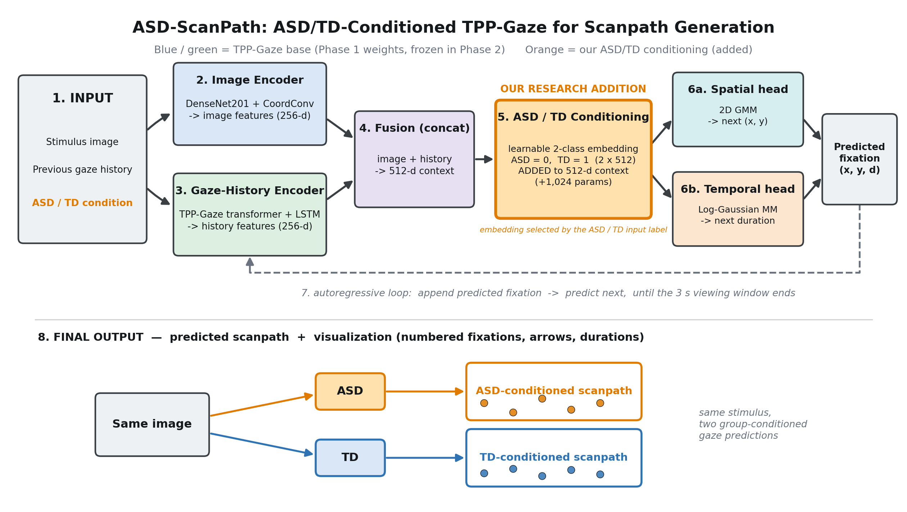

# ASD-ScanPath: Modelling Gaze Dynamics in Space and Time in ASD and TD Children

This repository contains the code and preprocessing pipelines for our research on **group-conditioned gaze modelling in Autism Spectrum Disorder (ASD) and Typically Developing (TD) children using Neural Temporal Point Processes**.

We adapt **TPP-Gaze**, a published model that combines deep neural networks with a Temporal Point Process (TPP) to jointly predict *where* the next fixation lands and *how long* it lasts. We fine-tune it on ASD and TD gaze data, add a small ASD/TD group embedding, and test the result on an external dataset.

> **⚠️ NOTE ON DATASETS:**  
> The datasets (Saliency4ASD, Gaze4ASD) used in this research are **NOT distributed in this repository** due to privacy and licensing restrictions. They must be obtained directly from their official sources.

> **⚠️ RESEARCH USE ONLY:**  
> These are group-level computational results. This is not a diagnostic or screening tool, and no clinical validity is established.

---

## 1. Overview and Motivation

**Research objective:** to test whether a small ASD/TD group embedding added to TPP-Gaze improves prediction of gaze scanpaths, whether any gain holds on an external dataset, and how closely generated scanpaths reproduce real ASD and TD behaviour.

Aggregate gaze statistics and static saliency maps discard the order and timing of fixations. A temporal point process models a scanpath as a sequence of events, so location and duration can be predicted together.



*Phase 2 architecture ([SVG version](docs/figures/architecture_diagram.svg)).*

The model has the following parts:
1. **Image encoder:** DenseNet201 with CoordConv, producing 256-d image features.
2. **Gaze-history encoder:** the TPP-Gaze Transformer and LSTM, producing 256-d history features.
3. **Spatial head:** a bivariate Gaussian mixture (16 components) over the next fixation location.
4. **Duration head:** a log-normal mixture (4 components) over the next fixation duration.

**Phase 2 is a group-conditioned model.** It adds a learned 2 x 512 ASD/TD embedding (**1,024 parameters**) to the fused 512-d context before both prediction heads. The whole base model is frozen during Phase 2 training, so only the embedding is trained.

**Results in brief:**
- Phase 2 gives a small in-domain likelihood gain (0.0073 nats per fixation) but **does not improve overall external likelihood**. On corrected Gaze4ASD, Phase 1 is better overall by 0.0172.
- Real ASD and TD children differ in spatial gaze measures. Generated scanpaths reproduce some of these differences too weakly, and get others wrong.
- **Temperature τ=1 is the selected behavioural-generation setting.** It improves external saccade-amplitude and revisit-rate similarity compared with τ=2, but it does not change the model or its likelihood. Fixation-count overproduction remains.
- The Gaze4ASD fit-to-height mapping is strongly supported but partly inferred, not experimentally confirmed.

---

## 2. Repository Structure

```
ASD-ScanPath/
├── configs/            # Model configuration reference
├── tppgaze/            # Original TPP-Gaze architecture (PyTorch), unmodified
├── training/           # Training, evaluation, statistics and temperature scripts
├── preprocessing/      # Scripts to process raw eye-tracking data
├── analysis/           # Early dataset audits and sensitivity analysis
├── results/            # Findings, limitations, tables and figures
│   ├── final_results/          # Current findings and limitations
│   ├── external_gaze4asd_v2/   # Corrected Gaze4ASD summaries, tables and figures
│   └── external_gaze4asd/      # SUPERSEDED: old mapping, kept for reproducibility
├── docs/               # Audits, dataset notes and architecture diagram
├── test/               # Inference demo folder
├── inference.py        # Scanpath generation and visualization
├── requirements.txt    # Python dependencies
└── README.md           # This file
```

Checkpoints, datasets and `training/runs/` (experiment outputs) are not tracked by Git.

---

## 3. Installation

1. **Clone the repository:**
   ```bash
   git clone https://github.com/Anish-R-18/ASD-ScanPath.git
   cd ASD-ScanPath
   ```
2. **Install dependencies:**
   ```bash
   pip install -r requirements.txt
   ```
*(Note: tested with Python 3.12 and PyTorch 2.3 on CPU for inference, and Python 3.13 and PyTorch 2.12 with CUDA for experiments. The evaluation scripts expect a GPU.)*

---

## 4. Dataset Acquisition
To replicate our experiments, you must request the following datasets from their respective authors:

1. **Saliency4ASD** (Primary Dataset): Used for Phase 1 & 2 training. Images are split 70/15/15 into train, validation and test, by image.
2. **Gaze4ASD** (External Evaluation): Used only with frozen models. It is separate in participants and images, but its stimulus selection may have used Saliency4ASD.

Place the downloaded raw data in an `external_data/` or `AdditionalData/` directory.

---

## 5. Preprocessing Pipeline

### 5.1 Saliency4ASD
Run the provided pipeline to clean the raw discrete coordinates:
```bash
python preprocessing/preprocess_dataset.py
```
**Key Cleaning Steps:**
- Removes the first fixation.
- Filters fixations with duration `< 60ms`.
- Truncates scanpaths to a `3.0s` maximum cumulative duration.
- Enforces a minimum length of 3 fixations.
- Normalizes coordinates to `[-1, 1]`.

### 5.2 Gaze4ASD (External Evaluation)
Run the corrected script to map screen coordinates to image-local space:
```bash
python preprocessing/preprocess_gaze4asd_v2.py
```
The primary mapping assumes each image is scaled to the `1440`-pixel height of the `2560x1440` screen and centred horizontally:

```
scale = 1440 / H
image_x = (X - (2560 - scale * W) / 2) / scale
image_y = Y / scale
```

This mapping is **strongly supported but partly inferred**. The original draw rectangle and presentation script are not available, so it is not experimentally confirmed. Policy A, the primary dataset, clips the 3.52% of fixations outside the image to its edges. Stretch and Policy B versions are written as sensitivity analyses.

> The original `preprocess_gaze4asd.py` assumed native-size centred stimuli. An audit found that this was contradicted by the data, so its results are **superseded** and must not be used. See [`results/external_gaze4asd/SUPERSEDED.txt`](results/external_gaze4asd/SUPERSEDED.txt).

---

## 6. Training Instructions

Set `images_dir` in each config to your local Saliency4ASD image folder, and place the pretrained TPP-Gaze weights at `tppgaze/data/model_transformer.pth` (see `tppgaze/download_models.sh`).

### Phase 1: Base TPP-Gaze Fine-Tuning
Fine-tune TPP-Gaze on combined ASD and TD data, with the DenseNet backbone frozen and no conditioning:
```bash
python training/train_tpp.py train --config training/config.yaml
```

### Phase 2: ASD/TD Conditioning
Starting from the Phase 1 checkpoint, freeze the whole base model and train only the 1,024-parameter group embedding:
```bash
python training/train_tpp_cond.py train --config training/config_phase2_embonly.yaml
```

Both scripts also accept `smoke` and `short` in place of `train` for quick checks.

---

## 7. Evaluation & Main Findings

NLL is negative log-likelihood per fixation; lower is better. All statistics are exploratory, except where marked. Full details: [`MAIN_FINDINGS.txt`](results/final_results/MAIN_FINDINGS.txt) and the [corrected Gaze4ASD results](results/external_gaze4asd_v2/README.md).

### 7.1 Phase 1 and Phase 2 on Saliency4ASD (held-out test)

| Model | Overall | ASD | TD |
|---|---|---|---|
| Pretrained (reference) | −0.1665 | | |
| Phase 1 | −0.4957 | −0.3164 | −0.6276 |
| Phase 2 | −0.5030 | −0.3250 | −0.6341 |

Phase 2 gains 0.0073 nats per fixation (1.48%) in-domain. This gain is small, and no confidence interval was computed.

### 7.2 Corrected Gaze4ASD External Evaluation

The frozen models were evaluated on 30 stimuli, with 33 ASD and 133 TD participants and 771 and 3,605 trials. Coordinates use the fit-to-height mapping with Policy A, which is strongly supported but partly inferred, not experimentally confirmed ([methodology](results/external_gaze4asd_v2/corrected_mapping_methodology.txt)).

The Phase 2 position prediction beats a centre-bias reference by 0.91 nats [0.78, 1.05] on 30 of 30 images.

### 7.3 Phase 1 vs Phase 2 External Comparison

Both models score the same trials in the same batches. A positive gain favours Phase 2.

| | Phase 1 | Phase 2 | Gain | 95% CI, participants | 95% CI, images |
|---|---|---|---|---|---|
| **Overall** | −0.5568 | −0.5396 | **−0.0172** | [−0.0224, −0.0122] | [−0.0324, −0.0018] |
| ASD | −0.1936 | −0.2039 | +0.0104 | [+0.0027, +0.0168] | [−0.0018, +0.0240] |
| TD | −0.6325 | −0.6096 | −0.0229 | [−0.0290, −0.0171] | [−0.0406, −0.0058] |

**Conditioning does not improve overall external likelihood.** The ASD gain clears zero only at participant level and is not ASD-specific: the ASD embedding also helps TD trials, and the TD embedding hurts both groups. Why the TD fit worsens has not been tested.

### 7.4 Real ASD vs TD on Gaze4ASD (participant level)

| Measure | Hedges' g | 95% CI | Direction |
|---|---|---|---|
| Revisit rate | −1.04 | [−1.44, −0.68] | ASD lower |
| Spatial dispersion | +0.80 | [+0.41, +1.24] | ASD higher |
| Total fixation time | −0.71 | [−1.11, −0.35] | ASD lower |
| Saccade amplitude | +0.65 | [+0.22, +1.11] | ASD higher |
| Direction concentration | +0.55 | [+0.11, +1.01] | ASD higher |

Fixation duration, fixation count, fixation rate and horizontal saccade fraction showed no significant difference.

### 7.5 Generated Behaviour on Gaze4ASD

10 seeds, 20 scanpaths per image and condition.

| ASD minus TD | Real | τ=1 | τ=2 | Assessment |
|---|---|---|---|---|
| Spatial dispersion | +.0169 | +.0101 | +.0078 | Direction matches; 60% / 46% of real |
| Saccade amplitude | +.0151 | +.0075 | +.0049 | Direction matches; 50% / 33% of real |
| Revisit rate | −.0805 | −.0237 | −.0124 | Direction matches; weak, 29% / 15% of real |
| Direction concentration | +.0270 | −.0054 | −.0091 | Wrong direction |
| Total fixation time | −.0822 | +.0189 | +.0250 | Wrong direction |

Fixation overproduction remains: at τ=1 the model generates 10.24 (ASD) and 9.62 (TD) fixations against 6.25 and 6.41 real.

### 7.6 Temperature Sensitivity

Temperature raises each spatial mixture sigma to the power τ, leaving means and weights unchanged. τ=1 is the original distribution. Every sigma here is below 1, so τ=2 narrows spatial spread, despite the usual meaning of "higher temperature". Durations are not tempered.

**τ=1 was selected on Saliency4ASD validation images**, then checked once on Gaze4ASD with paired seeds:

| Per-image error | ASD, τ=1 vs τ=2 | TD, τ=1 vs τ=2 |
|---|---|---|
| Saccade amplitude | .0179 vs .0377 (52.5% lower) | .0138 vs .0276 (49.9% lower) |
| Revisit rate | .0569 vs .1681 (66.1% lower) | .0449 vs .1032 (56.5% lower) |

These four tests were prespecified but not preregistered, and all favour τ=1 in 10 of 10 seeds. Fixation duration, count, rate and total time do not improve, and direction concentration is slightly worse. The TD revisit improvement reverses within the real viewing window. **This is a behavioural result, not a likelihood improvement.**

### 7.7 Current Limitations
- **Mapping:** the Gaze4ASD display mapping is strongly supported but partly inferred.
- **Conditioning:** the small in-domain gain does not carry over to overall external likelihood.
- **Generated behaviour:** fixation counts and total time are too high, some group differences have the wrong direction, and revisit differences are under-reproduced.
- **Independence:** Gaze4ASD stimulus selection may have used Saliency4ASD. Its stimuli were chosen for group differences.
- **Participants:** Saliency4ASD has no participant IDs across images. Groups are unbalanced on Gaze4ASD, and age is not adjusted.
- **Model quirk:** the original TPP-Gaze Transformer attends across the batch dimension; this was reproduced, not fixed.
- **Statistics:** analyses are exploratory, not preregistered confirmatory evidence.

Full list: [`LIMITATIONS.txt`](results/final_results/LIMITATIONS.txt).

---

## 8. Inference / Demo

We provide a standalone inference tool to generate predicted scanpaths for any input image conditioned on either ASD or TD behavior. The model outputs predicted fixation coordinates along with predicted continuous durations. It needs the Phase 2 checkpoint at `training/runs/phase2_embedding_only/best_model_conditioned.pth`, which is not distributed in this repository.

The visualizer renders the sequence as numbered points connected by arrows, where circle size corresponds to fixation duration and explicit time labels are attached.

**Example Commands:**
Generate an ASD-conditioned scanpath:
```bash
python inference.py --image path/to/image.png --condition ASD
```
Generate a TD-conditioned scanpath:
```bash
python inference.py --image path/to/image.png --condition TD
```
Generate both conditions side-by-side for visual comparison:
```bash
python inference.py --image path/to/image.png --condition both
```
Use a different sampling temperature:
```bash
python inference.py --image path/to/image.png --temperature 2.0
```

Sampling uses **τ=1 by default**, the selected behavioural-generation setting. τ=2 is the value in the official TPP-Gaze config. Temperature changes sampling only: τ=1 is not a likelihood improvement. Use `--seed` to change the random seed. The same seed can give different scanpaths on a different PyTorch version, although the model's outputs and likelihoods agree (checked on 2.3 and 2.15).

Outputs (saved to `test/outputs/<image_name>/` by default; `--out-dir` changes the parent folder):
- `<condition>_scanpath.png`: Visualized scanpath over the image.
- `<condition>_scanpath.json`: `scanpath_pixels` as `[x, y, duration_in_seconds]`, clipped to the image, and `scanpath_normalized` as sampled.
- `<image_name>_asd_vs_td.png`: A side-by-side comparison figure (if `--condition both` is used).

Generated scanpaths show model behaviour for research. They must not be used to assess any individual.

---

## 9. Reproducing Figures & Tables
Run these from the repository root. They read the datasets and checkpoints, and write to `training/runs/`.

> **Overwriting:** `eval_external_v2.py`, `compare_phase1_phase2.py run`, `temperature_sensitivity.py run` and `eval_gaze4asd_tau1.py run` refuse to overwrite an existing output folder. `analyze_phase2.py`, `stats_external_v2.py`, `gen_replicates_v2.py` and the `analyze` steps do not, so back up earlier results before rerunning them.

| Step | Command |
|---|---|
| Saliency4ASD behavioural analysis | `python training/analyze_phase2.py` |
| Corrected Gaze4ASD evaluation | `python training/eval_external_v2.py` |
| Statistics and figures | `python training/stats_external_v2.py` |
| Generation replicates at τ=2 | `python training/gen_replicates_v2.py` |
| Phase 1 vs Phase 2 | `python training/compare_phase1_phase2.py run`, then `verify`, then `analyze` |
| Temperature selection (validation) | `python training/temperature_sensitivity.py run`, then `windowed`, then `analyze` |
| Gaze4ASD at τ=1 | `python training/eval_gaze4asd_tau1.py run`, then `analyze` |
| Tracked corrected summaries | `python training/build_results_v2.py` (replaces `results/external_gaze4asd_v2/`) |

Summaries are in [`results/final_results/`](results/final_results/README.txt) and [`results/external_gaze4asd_v2/`](results/external_gaze4asd_v2/README.md). Items based on the old Gaze4ASD mapping are listed in [`SUPERSEDED.txt`](results/final_results/SUPERSEDED.txt).

---

## 10. Citation
If you use this code in your research, please cite:

```bibtex
@article{ASDScanPath2026,
  title={ASD-ScanPath: Modelling Gaze Dynamics in Space and Time in ASD and TD Children},
  author={Anish, R. and et al.},
  journal={TBD},
  year={2026}
}
```

*(Placeholder: Update with official publication details once accepted).*

Please also cite the original TPP-Gaze paper, which this work builds on: *TPP-Gaze: Modelling Gaze Dynamics in Space and Time with Neural Temporal Point Processes* (see `docs/`).
