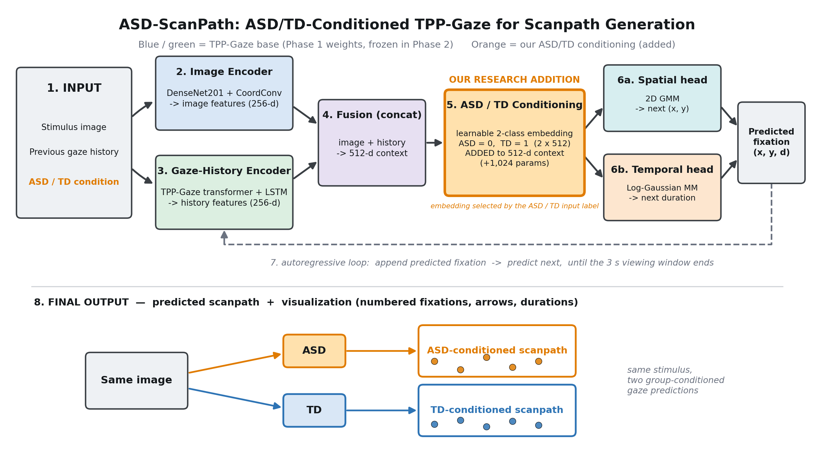

# Architecture

The figure is drawn by [`../scripts/make_architecture_diagram.py`](../scripts/make_architecture_diagram.py) (Mermaid source: [`figures/architecture_diagram.mmd`](figures/architecture_diagram.mmd)).

## Original TPP-Gaze (unchanged)

**Where it lives.** [`../tppgaze/`](../tppgaze/README.md) is the official TPP-Gaze repository ([github.com/phuselab/tppgaze](https://github.com/phuselab/tppgaze)).
- **Version.** Commit `59cf572` (2025-02-20), MIT licence.
- **Unmodified.** Every distributed file is byte-identical to upstream (the sample photo `data/1009.jpg` is not distributed; see [`../tppgaze/UPSTREAM.md`](../tppgaze/UPSTREAM.md)), and `tests/test_repository_hygiene.py` checks this against [`../tests/data/tppgaze_upstream_59cf572.sha256`](../tests/data/tppgaze_upstream_59cf572.sha256).
- **How we use it.** All our changes live outside this folder, as wrappers.

**Components:**

| Component | Details |
|---|---|
| Image encoder | Input resized to 512 × 512. DenseNet201 (ImageNet weights via `torch.hub`) gives 2,048 channels; CoordConv adds coordinate channels (2,051); three 1 × 1 convolutions and a linear layer give a 256-d image vector *z*. |
| History encoder | Each past fixation is represented by its location and normalised log-duration (sinusoidal encoding). Four transformer layers (four heads) and an LSTM give a 256-d state *h*. A learned initial state is used before the first fixation. |
| Fusion | *c* = [*h* ‖ *z*] ∈ ℝ⁵¹² (`cat` merge) |
| Duration head | 4-component log-normal mixture over log-durations normalised by the training-split mean and standard deviation |
| Spatial head | 16-component bivariate Gaussian mixture with diagonal covariance (tanh on the means) |
| Objective | Joint NLL of duration and location per fixation, with no survival term |
| Sampler | Autoregressive. Samples a duration and a location, appends them to the history, and repeats until the 3 s window is filled. Temperature τ raises each spatial σ to the power τ. |

**Parameter counts:**
- base model: 23,895,712 parameters;
- outside the frozen DenseNet201: 3,881,784, which is what Phase 1 trains;
- Phase 2: 1,024 trainable parameters, for 23,896,736 in total.

### Released-code behaviour we kept

**Batch-dimension attention.** The released transformer sets `batch_first=False`, but it receives tensors ordered (batch, length, dimension). So attention runs across the scanpaths in a batch, not along each sequence; temporal order comes from the LSTM.
- **Why we kept it.** The pretrained weights were learned with this behaviour, so we kept it for fidelity rather than fixing it.
- **Effect on likelihood.** Small: on Gaze4ASD, shuffling batch composition changed overall NLL by about 0.0001 or less.
- **Effect on generation.** The scanpaths sampled together (20 per call) share one image and label and can influence each other.
- **Where to find it.**
  - The code is in [`../tppgaze/tppgaze/models/transformer_encoder.py`](../tppgaze/tppgaze/models/transformer_encoder.py).
  - The batch-shuffling check is recorded as `shuffled_batches` by [`../training/eval_external_v2.py`](../training/eval_external_v2.py) and [`../training/compare_phase1_phase2.py`](../training/compare_phase1_phase2.py).
  - It is listed in [`limitations.md`](limitations.md).

**Other released-code details:**
- the log-scales of the duration components are clamped to [−5, 3];
- the configuration sets τ = 2 (we use τ = 1, chosen on validation data);
- generated coordinates are clipped to the image only for measurement and output, as in the released output code. The unclipped values remain in the sampler's history.

## Our modifications

| File | What it does |
|---|---|
| [`../training/conditioned.py`](../training/conditioned.py) | `ConditionedTPPGaze` wraps the unmodified `TPPGaze` and adds `group_emb = nn.Embedding(2, 512)` (ASD = 0, TD = 1), initialised to zero. |
| [`../training/model_utils.py`](../training/model_utils.py) | Builds the official model with our duration statistics, loads checkpoints, freezes the backbone, caches backbone features, and computes the joint NLL through the model's own submodules. The optional condition is added to the fused context: *c̃* = *c* + *e*ℓ. |
| [`../training/generate_cond.py`](../training/generate_cond.py) | Conditioned sampler. It mirrors the official `TPPGaze.sample()` and adds the embedding at every step, at the same point as in training. |
| [`../training/train_tpp.py`](../training/train_tpp.py), [`../training/train_tpp_cond.py`](../training/train_tpp_cond.py) | Phase 1 and Phase 2 trainers (AdamW, early stopping, best-checkpoint saving, logging, `smoke` checks) |
| [`../inference/inference.py`](../inference/inference.py) | Generation and visualisation with the same sampler |

**Why add the embedding to the context.**
- **Single point of influence.** One vector added before both heads can shift both the next location and the next duration, while the pretrained encoders stay exactly as released.
- **Pretrained heads load unchanged.** Because the vector is added rather than concatenated, the heads' input size does not change.
- **Untested alternatives.** Other injection points were not tested.

**Equivalence checks**
- `python training/train_tpp_cond.py smoke` checks that a zero embedding gives identical ASD and TD likelihoods, and that a non-zero embedding changes them.
- `tests/test_conditioning.py` repeats this on a randomly initialised model.
- `tests/test_checkpoints.py` (when the checkpoints are present) checks that the Phase 2 checkpoint holds the 1,290 Phase 1 tensors unchanged, plus `group_emb.weight`.

## Two modes of use

- **Likelihood evaluation.** Scores observed scanpaths, using the observed history and no temperature.
- **Behavioural generation.** Samples scanpaths autoregressively at temperature τ (τ = 1 by default).

Temperature affects only generation, never the likelihood.
